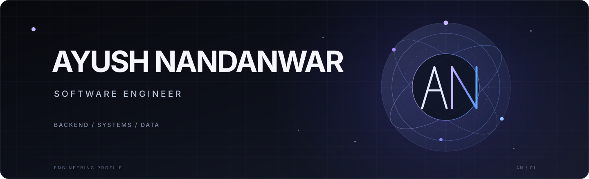

<!-- Profile README for ayushnandanwar | Minimal, creative engineering portfolio -->

  

  

    
    
    
  

  <h3>Senior Software Engineer · Backend Engineering · AdTech / MarTech</h3>
  
📍 Pune, India

  

---

<table>
  <tr>
    <td width="50%" valign="top">

### 01 / About me

I'm a software engineer focused on **product engineering** and building systems that are practical, scalable, and maintainable. I enjoy working across the stack—from shaping product ideas and designing APIs to improving data workflows and delivering user-facing features.

- 🚀 Building backend systems for **AdTech and MarTech** product experiences.
- ⚙️ Focused on **backend architecture, distributed systems, databases, and performance**.
- 🧩 Comfortable moving between product thinking, engineering, and execution.
- 🤖 Exploring how AI tools can improve software development and product workflows.
- 🌱 Always learning, building, and iterating.

</td>
<td width="50%" valign="top">

### 02 / Current toolkit

**Languages & runtime**

**Backend & data**

**Cloud & tools**

</td>
  </tr>
</table>

---

## 03 / Selected projects

<table>
  <tr>
    <td width="50%" valign="top">
      <h3>🎓 India PYQ Platform</h3>
      A platform focused on helping students discover and practice previous-year questions for exams across India.
        
      
      
      
        
      <a href="https://india-pyq-platform.vercel.app/">Live application ↗</a>
    </td>
    <td width="50%" valign="top">
      <h3>⌨️ <a href="https://keyflows.github.io/">KeyFlows</a></h3>
      A lightweight typing practice experience designed to help users build speed, accuracy, and consistency.
        
      
      
      
        
      <a href="https://keyflows.github.io/">Visit KeyFlows ↗</a>
    </td>
  </tr>
  <tr>
    <td width="50%" valign="top">
      <h3>🧰 <a href="https://github.com/ayushnandanwar/pdf-utils">PDF Utils</a></h3>
      A Python utility for batch OCR processing that converts scanned PDFs into searchable documents using Tesseract and PyMuPDF.
        
      
      
      
        
      <a href="https://github.com/ayushnandanwar/pdf-utils">Explore repository ↗</a>
    </td>
    <td width="50%" valign="top">
      <h3>Backend engineering focus</h3>
      API design · Data modelling · Caching · Distributed systems · Performance
        
      A selection of the engineering areas I enjoy exploring and applying in production.
    </td>
  </tr>
</table>
---

## 04 / GitHub activity

  
  
   
  

## 05 / What I'm interested in

- Designing reliable, high-throughput backend services.
- Distributed systems, caching strategies, and data-intensive applications.
- Building products from idea to launch.
- Applying AI thoughtfully to engineering and productivity.

---

  <h3>Let's build something meaningful.</h3>
  

    <a href="https://ayushnandanwar.github.io/">Portfolio</a> &nbsp;·&nbsp;
    <a href="https://www.linkedin.com/in/ayush-nandanwar/">LinkedIn</a> &nbsp;·&nbsp;
    <a href="https://github.com/ayushnandanwar">GitHub</a>
  

  Designed with a builder's mindset · Updated with care

